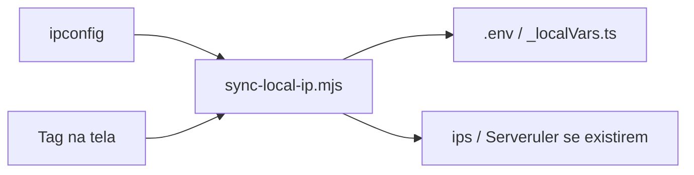

<p align="center">
  <strong>sync-local-ip</strong>
</p>

<p align="center">
  <strong>Seu IP local muda. Seus `.env` acompanham.</strong><br />
  Descobre o IPv4 útil no Windows e grava nos clones — sem abrir dezenas de arquivos à mão.
</p>

---

## Por que existe

Trocar de rede (empresa ↔ casa) quebra bookmarks, Serveruler e `.env` com IP antigo. Editar tudo manualmente é o tipo de tarefa que você esquece até o serviço não abrir.

## O que você ganha

| | |
|---|---|
| **Detecção** | IPv4 certo (Ethernet/Wi-Fi; ignora WSL/VirtualBox) |
| **Perfil** | Empresa (`10.10.0.x`) vs casa (`172.24` / `10.20` / `192.168`) |
| **Propagação** | `.env`, `.env.local`, `_localVars.ts` em `scanRoots` |
| **Extras** | `ips/table.ts`, `data.json`, redirect do Serveruler quando existirem |
| **Tag na tela** | Verde alinhado / vermelho desalinhado |

## Como funciona



Só lê a rede e grava arquivos locais. Não sobe servidores, não altera a placa de rede e não envia dados para fora.

## Posicionamento

| sync-local-ip é | Não é |
|---|---|
| Propagador de IP em disco | VPN / DHCP server |
| Companion do Serveruler | UI web de inventário |
| Windows-first | Daemon multiplataforma completo |

## Stack (em uma linha)

Node 20+ · Windows · `config.json` a partir do example.

Detalhes: [`docs/context.md`](docs/context.md) · rede/arquivos: [`docs/rede-e-arquivos.md`](docs/rede-e-arquivos.md) · tag: [`docs/tag.md`](docs/tag.md).

## Começar

Config e operação: [`docs/ambiente-e-operacao.md`](docs/ambiente-e-operacao.md) · configuração detalhada: [`docs/configuracao.md`](docs/configuracao.md) · CLI: [`docs/linha-de-comando.md`](docs/linha-de-comando.md).

```powershell
copy config.example.json config.json
# edite userKey, reposRoot, scanRoots
```

Contribuição: [`CONTRIBUTING.md`](CONTRIBUTING.md) · conduta: [`CODE_OF_CONDUCT.md`](CODE_OF_CONDUCT.md) · mudanças: [`CHANGELOG.md`](CHANGELOG.md).
